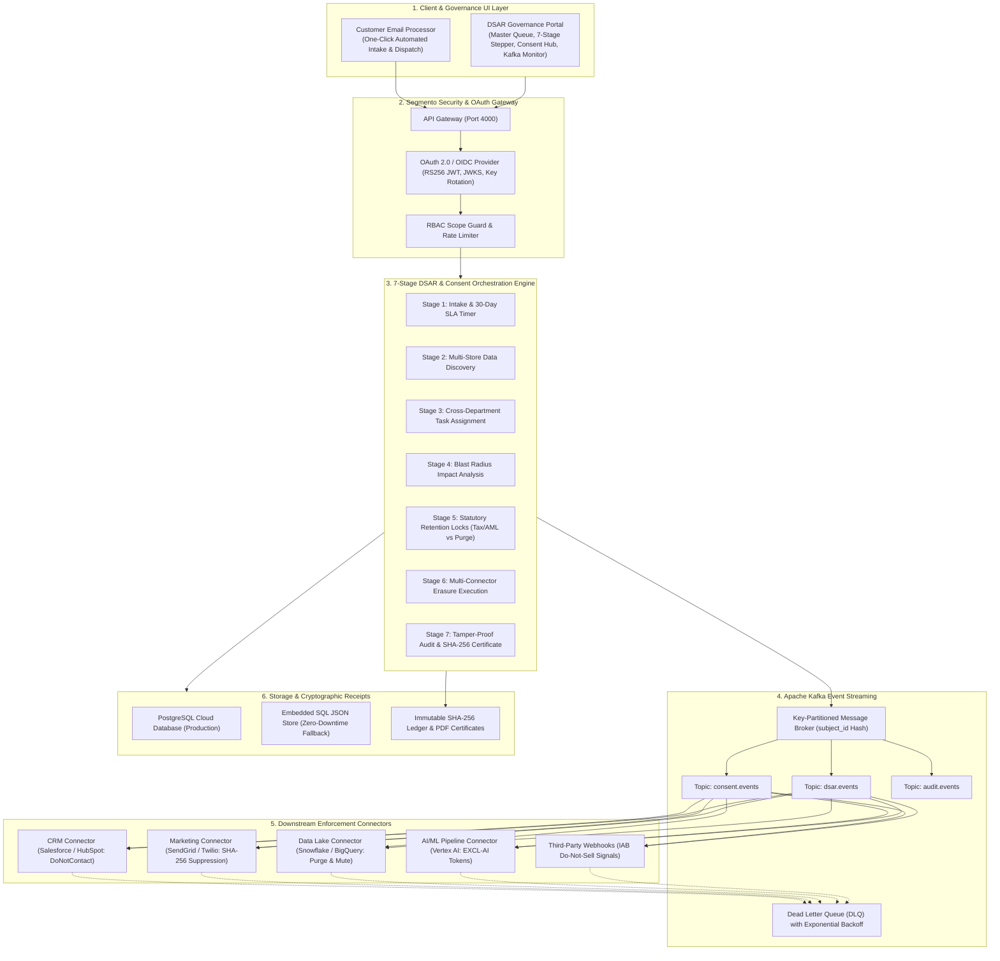

# Segmento Protect — Enterprise DSAR & Statutory Privacy Portal

[](https://nodejs.org/)
[]()
[-success.svg)]()
[]()
[](https://dsar-portal.onrender.com)

> **Segmento Protect DSAR Portal**: An enterprise-grade, standalone **Data Subject Access Request (DSAR)** and **Consent Lifecycle Management** microservice. Implements statutory compliance with:
> - **India DPDP Act 2023 (Sections 6(4), 11, 12)**
> - **GDPR (Articles 7(3), 15, 17 Right to Erasure, 21)**
> - **Singapore PDPA (Section 16)**
> - **California CCPA / CPRA**
> - **Statutory Financial Retention Locks (RBI Master Direction / CGST Act Sec. 36)**

🌐 **Live Deployed Application**: [https://dsar-portal.onrender.com](https://dsar-portal.onrender.com)  
📖 **Architecture & Flow Guide**: [DSAR Portal Architecture Documentation](docs/DSAR_PORTAL_ARCHITECTURE_AND_FLOW.md)

---

## 🏗️ System Architecture & 7-Stage Pipeline



---

## 📁 Repository Structure

The codebase is organized into a clean, decoupled microservice architecture:

```
dsar-portal/
├── backend/                       # Server-Side Microservice Architecture
│   ├── server.js                  # Primary Express application & API router mounting
│   ├── routes/                    # REST API Endpoints
│   │   ├── dsar.routes.js         # DSAR intake, queue, stepper stages & email processing
│   │   ├── consent.routes.js      # 5-Category consent matrix & revocation
│   │   ├── kafka.routes.js        # Kafka partition inspector & event bus diagnostics
│   │   └── mail.routes.js         # Nodemailer dispatch, preview & audit history
│   ├── services/                  # Domain Business Logic Services
│   │   ├── dsar-service.js        # Core DSAR lifecycle state machine
│   │   ├── dsar-policy-service.js # Statutory legal hold & tax retention evaluation
│   │   ├── kafka-service.js       # In-memory / distributed Kafka partition broker
│   │   ├── kafka-consumers.js     # 5 Downstream enforcement connector consumers
│   │   ├── consent-service.js     # Consent withdrawal state machine & receipts
│   │   └── email-notification-service.js # Live SMTP & Ethereal test webmail generator
│   ├── database/                  # Data Layer (PostgreSQL & JSON store fallback)
│   │   ├── db.js                  # Dual-mode database interface
│   │   ├── local-db.js            # In-memory ACID persistence engine
│   │   ├── consent-ledger.json    # Cryptographic SHA-256 consent log
│   │   └── udps_local_db.json     # Active mock enterprise dataset
│   └── gateway/                   # OAuth 2.0 / OIDC Provider & Security Guards
│
├── frontend/                      # Client-Side Governance & Compliance UI
│   └── public/
│       ├── index.html             # Enterprise DSAR governance single-page application
│       ├── css/                   # Enterprise responsive stylesheets & theme variables
│       └── js/                    # Decoupled ES6 Single-Responsibility Controllers
│           ├── app.js             # Main SPA bootstrapper with error-isolated module loader
│           ├── dsar-stepper.js    # Interactive 7-Stage Compliance Stepper
│           ├── dsar-intake.js     # Intake form & One-Click Customer Email Processing
│           ├── dsar-dashboard.js  # Master DSAR Queue & SLA Countdown monitor
│           ├── dsar-discovery.js  # Multi-store PII discovery scanner
│           ├── dsar-detail.js     # Deep audit inspector for individual DSAR cases
│           ├── dsar-assignment.js # Multi-department task routing & delegation
│           ├── dsar-impact.js     # Blast radius impact analysis
│           ├── dsar-policy.js     # Statutory tax exemption vs erasure policy engine
│           ├── dsar-execution.js  # Multi-connector cryptographic erasure executor
│           ├── dsar-verification.js # Residual PII zero-exposure validator
│           ├── dsar-certificate.js # Cryptographic SHA-256 certificate & email dispatch
│           ├── dsar-team-config.js # Department leads & DPO configuration
│           ├── dsar-settings.js   # Statutory SLA thresholds & platform preferences
│           ├── dsar-profile.js    # Operator persona switcher (DPO, Security, Auditor)
│           ├── consent-hub.js     # 5-Category Consent Matrix & Kafka Event Monitor
│           ├── theme.js           # Dark / Light mode theme switcher
│           └── toast.js           # Non-blocking notification banner
│
├── tests/                         # Automated Jest Test Suites (19 suites, 159 tests passed)
│   ├── customer-mail-request.test.js # One-click email intake & automated dispatch
│   ├── kafka-consent-integration.test.js # Kafka event streaming & 5 consumers
│   ├── consent-withdrawal.test.js # 5-Category consent state transitions
│   ├── data-deletion-api.test.js  # 7-Stage deletion orchestrator
│   ├── dsar-policy.test.js        # Statutory retention locks (Tax/AML vs Purge)
│   ├── dsar-verification.test.js  # Residual scan & SHA-256 tamper verification
│   └── ...                        # 19 comprehensive test suites
│
├── docs/                          # Architecture PDF & System Specifications
├── server.js                      # Root microservice entry point
├── package.json                   # Dependencies & npm scripts
├── render.yaml                    # Automated cloud deployment blueprint
└── README.md                      # Executive documentation
```

---

## ⚡ Quick Start (60 Seconds)

### 1. Clone the repository
```bash
git clone https://github.com/Manojya1701/dsar_portal-.git
cd dsar_portal-
```

### 2. Install dependencies
```bash
npm install
```

### 3. Start the microservice
```bash
npm start
```

### 4. Open in your browser
* **Web Portal**: [http://localhost:4000](http://localhost:4000)
* **Health Check**: [http://localhost:4000/api/health](http://localhost:4000/api/health)
* **OIDC Discovery**: [http://localhost:4000/.well-known/openid-configuration](http://localhost:4000/.well-known/openid-configuration)
* **OAuth JWKS**: [http://localhost:4000/.well-known/jwks.json](http://localhost:4000/.well-known/jwks.json)

---

## 🧪 Automated Test Suite

Verify 100% automated test coverage across all 19 test suites:

```bash
npm test
```

### Test Coverage Breakdown:
* **19 Test Suites Passed (159 Tests Green)**
  * `customer-mail-request.test.js`: One-click email request intake, auto-fill, and dispatch.
  * `kafka-consent-integration.test.js`: Kafka event partitions, 5 downstream consumers, and DLQ retries.
  * `consent-withdrawal.test.js`: 5-category consent state machine & SHA-256 receipts.
  * `gateway-oauth.test.js`: RS256 token issuance, OIDC discovery, JWKS, rate limiting.
  * `data-deletion-api.test.js`: 7-stage deletion orchestrator & SLA countdown.
  * `dsar-policy.test.js`: Statutory retention locks (Tax/AML 7-year lock vs PII erasure).
  * `dsar-verification.test.js`: SHA-256 certificate generation & cryptographic tamper detection.
  * `dsar-discovery.test.js`: Multi-repository PII scan and indexing.
  * `dsar-impact.test.js`: Downstream blast radius analysis.
  * `dsar-settings-email.test.js`: SLA thresholds, SMTP alerts, and team routing.

---

## 🚀 Key Feature Highlights

### 1. 7-Stage Statutory Compliance Stepper
Guides the compliance operator through each legal milestone:
1. **Intake & Verification**: Capture subject request & initiate 30-day statutory countdown timer.
2. **PII Discovery**: Scan all databases (PostgreSQL, CRM, Snowflake Lakehouse).
3. **Department Assignment**: Route subtasks to CRM, Marketing, Data Eng, and Legal teams.
4. **Impact Analysis**: Preview blast radius before any destructive action.
5. **Legal Policy Locks**: Automatically retain tax/billing invoices while scheduling PII for purge.
6. **Execution**: Multi-connector cryptographic erasure, anonymization, and masking.
7. **Tamper-Proof Audit**: Generate immutable SHA-256 audit certificate.

### 2. Zero-Friction One-Click Customer Email Processing
Automates handling of unstructured inbound email deletion requests:
* **One-Click Auto-Fill**: Auto-populates customer data (`Priya Nair`, `priya.nair@example.in`) with single click.
* **Instant Orchestration**: Directly creates DSAR request, runs discovery, and evaluates legal locks.
* **Live Email Dispatch**: Generates and sends a formal statutory completion certificate email with live webmail preview link.

### 3. Kafka Downstream Synchronization (5 Connectors)
Real-time key-partitioned event queue synchronizing opt-outs and erasures:
* **Salesforce / HubSpot**: Sets `DoNotContact` and redacts profile records.
* **SendGrid / Twilio**: Adds SHA-256 suppression hash to prevent further marketing.
* **Snowflake Lakehouse**: Purges or pseudonymizes analytics logs.
* **Vertex AI**: Replaces training features with `EXCL-AI-XXXX` surrogate tokens.
* **Ad Exchanges**: Fires standard IAB Do-Not-Sell signals.

---

## 📡 REST API Reference

| Endpoint | Method | Description |
|---|---|---|
| `POST /api/dsar/process-email-request` | `POST` | One-click auto-process customer email request and dispatch certificate |
| `POST /api/v1/deletions/intake` | `POST` | Register new DSAR request & start 30-day SLA clock |
| `GET /api/v1/deletions/queue` | `GET` | Fetch master DSAR queue with SLA countdowns |
| `POST /api/v1/deletions/:id/discover` | `POST` | Scan connected databases for subject records |
| `POST /api/v1/deletions/:id/plan` | `POST` | Evaluate statutory policies & generate 6-action plan |
| `POST /api/v1/deletions/:id/execute` | `POST` | Execute cryptographic erasure across connectors |
| `POST /api/v1/deletions/:id/verify` | `POST` | Perform residual PII scan & verify 0 leaks |
| `GET /api/v1/deletions/:id/audit` | `GET` | Retrieve immutable SHA-256 compliance certificate |
| `GET /api/v1/consent/status` | `GET` | Retrieve live 5-category consent matrix |
| `POST /api/v1/consent/withdraw` | `POST` | Revoke consent, emit Kafka event, and generate proof receipt |
| `GET /api/v1/consent/kafka/events` | `GET` | Inspect real-time Kafka partition offsets and consumer log |

---

## 📄 License & Ownership
Proprietary & Confidential &mdash; Segmento Data Systems & Governance Technologies. All rights reserved.
