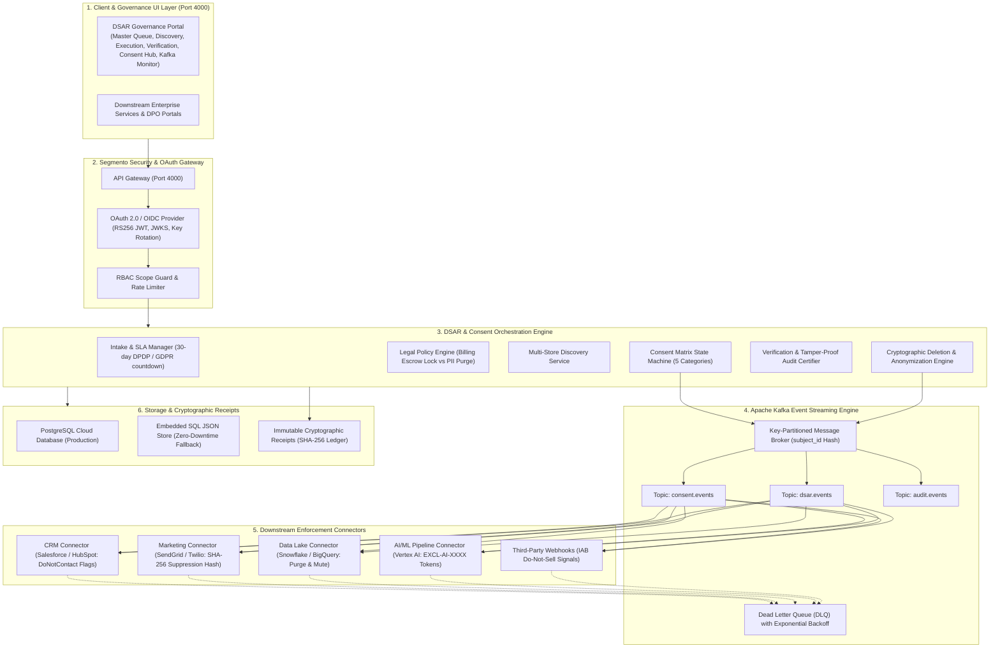

# Segmento DSAR Portal & Consent Hub

[](https://nodejs.org/)
[]()
[-success.svg)]()
[]()

An enterprise-grade, standalone **Data Subject Access Request (DSAR)** and **Consent Lifecycle Management** microservice implementing statutory compliance with:
* **GDPR (Articles 7(3), 15, 17, 21)**
* **India DPDP Act 2023 (Sections 6(4), 11, 12)**
* **Singapore PDPA (Section 16)**
* **California CCPA / CPRA**
* **Statutory Financial Retention Locks (RBI Master Direction / CGST Act Sec. 36)**

---

## 🏗️ System Architecture



---

## ⚡ Quick Start

### 1. Prerequisites
- **Node.js**: v18.0.0 or higher
- **npm**: v9.0.0 or higher

### 2. Installation
```bash
git clone https://github.com/Manojya1701/dsar_portal.git
cd dsar_portal
npm install
```

### 3. Environment Configuration
Copy the sample environment file:
```bash
cp .env.example .env
```
Default parameters in `.env`:
```ini
PORT=4000
NODE_ENV=production
UDPS_CORE_URL=http://localhost:3000
KAFKA_CLIENT_ID=segmento-dsar-portal
JWT_SECRET=segmento_dsar_portal_jwt_secret_key_2026
DATABASE_URL=
```
*(If `DATABASE_URL` is omitted, the microservice automatically runs on the high-performance local JSON storage fallback with 100% feature parity).*

### 4. Boot the Microservice
```bash
npm start
```
Once booted:
* **Web UI**: [http://localhost:4000](http://localhost:4000)
* **Health Check**: [http://localhost:4000/api/health](http://localhost:4000/api/health)
* **OpenID Discovery**: [http://localhost:4000/.well-known/openid-configuration](http://localhost:4000/.well-known/openid-configuration)
* **OAuth JWKS**: [http://localhost:4000/.well-known/jwks.json](http://localhost:4000/.well-known/jwks.json)
* **Architecture PDF**: [http://localhost:4000/docs/DSAR_Portal_Architecture_and_Flow.pdf](http://localhost:4000/docs/DSAR_Portal_Architecture_and_Flow.pdf)

---

## 🧪 Automated Test Suite

Run the full automated test suite:
```bash
npm test
```

### Test Coverage Summary:
* **18 Test Suites (156 Passed)**
  * `kafka-consent-integration.test.js`: End-to-end Kafka event bus, partition routing, 5 downstream consumers, and DLQ retries.
  * `consent-withdrawal.test.js`: 5-category consent state transitions and revocation receipts.
  * `gateway-oauth.test.js`: RS256 token issuance, OIDC discovery, JWKS, rate limiting, and RBAC guards.
  * `data-deletion-api.test.js`: 7-stage deletion orchestrator, SLA countdown, and approval gates.
  * `dsar-policy.test.js`: Statutory retention locks (tax/billing 7-year lock vs PII erasure).
  * `dsar-verification.test.js`: SHA-256 certificate generation and cryptographic tamper detection.
  * `dsar-discovery.test.js`: Multi-repository PII scan and indexing.
  * `dsar-impact.test.js`: Downstream blast radius analysis.
  * `dsar-settings-email.test.js`: SLA thresholds, SMTP alerts, and team routing.

---

## 📡 API Reference

### 1. OAuth 2.0 & OIDC Gateway
| Endpoint | Method | Description | Scope Required |
|---|---|---|---|
| `/.well-known/openid-configuration` | GET | RFC 8414 OpenID Connect Discovery document | None |
| `/.well-known/jwks.json` | GET | Public JSON Web Key Set (RS256) | None |
| `/oauth/token` | POST | Issue signed JWT bearer tokens | None |

### 2. DSAR Deletion Lifecycle
| Endpoint | Method | Description |
|---|---|---|
| `/api/v1/deletions/intake` | POST | Register new DSAR request & start 30-day SLA clock |
| `/api/v1/deletions/queue` | GET | Fetch paginated requests with SLA filter |
| `/api/v1/deletions/plan` | POST | Run statutory policy rules & calculate retention locks |
| `/api/v1/deletions/execute` | POST | Execute cryptographic erasure across data stores |
| `/api/v1/deletions/verify` | GET / POST | Validate SHA-256 verification hash & generate signed certificate |
| `/api/v1/deletions/settings` | GET / PUT | Update SLA deadlines, alert thresholds, and DPO team routing |

### 3. Consent Matrix & Kafka Event Bus
| Endpoint | Method | Description |
|---|---|---|
| `/api/v1/consent/status` | GET | Retrieve live consent matrix across all 5 statutory categories |
| `/api/v1/consent/withdraw` | POST | Revoke category consent, emit Kafka event, and generate SHA-256 receipt |
| `/api/v1/consent/history` | GET | Fetch audit trail of all historical consent state changes |
| `/api/v1/consent/kafka/events` | GET | Inspect real-time Kafka partition offsets, consumers, and message log |

---

## 🚀 Deployment Guide (Render.com)

This repository includes native [Render Blueprint](https://render.com/docs/blueprint-spec) configuration (`render.yaml`).

### Option A: 1-Click Blueprint Deploy
1. Push this repository to GitHub: `https://github.com/Manojya1701/dsar_portal.git`
2. Log in to [Render Dashboard](https://dashboard.render.com/).
3. Click **New +** -> **Blueprint**.
4. Select the `dsar_portal` repository.
5. Render reads `render.yaml` and deploys your standalone web service automatically!

### Option B: Manual Web Service Deploy
1. Click **New +** -> **Web Service**.
2. Connect your `dsar_portal` GitHub repository.
3. Set the following settings:
   - **Name**: `segmento-dsar-portal`
   - **Environment**: `Node`
   - **Region**: `Oregon` or `Singapore`
   - **Branch**: `main`
   - **Build Command**: `npm install`
   - **Start Command**: `node server.js`
   - **Health Check Path**: `/api/health`
4. Under **Environment Variables**, add:
   - `NODE_VERSION` = `20`
   - `PORT` = `10000`
   - `NODE_ENV` = `production`
   - `JWT_SECRET` = `<any-secure-random-string>`
   - `DATABASE_URL` = *(Optional: attach Render PostgreSQL or leave blank for local store)*
5. Click **Create Web Service**. Your live URL will be generated:
   `https://segmento-dsar-portal.onrender.com`

---

## 📄 License
Proprietary & Confidential - Segmento Data Systems & Governance Technologies. All rights reserved.
